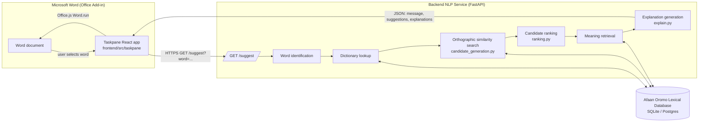
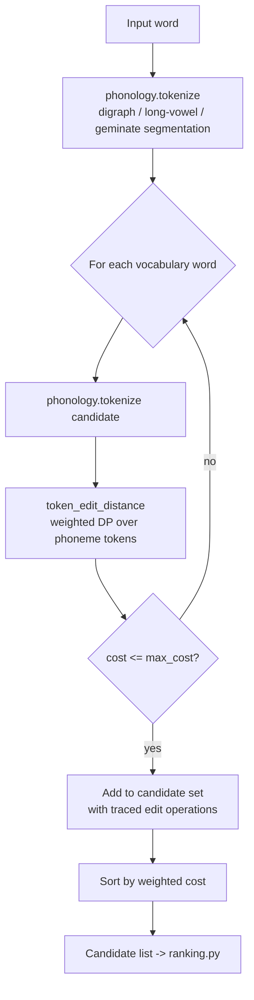
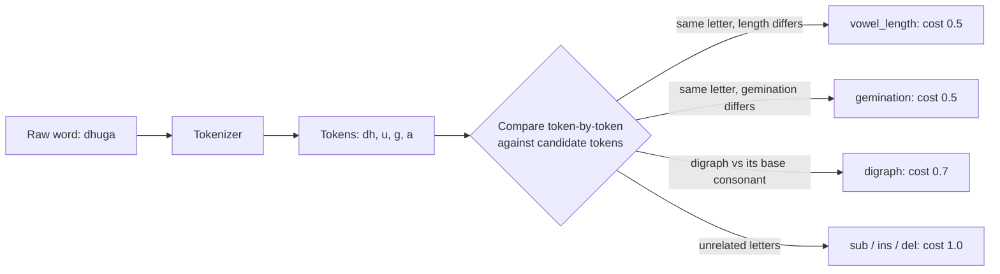
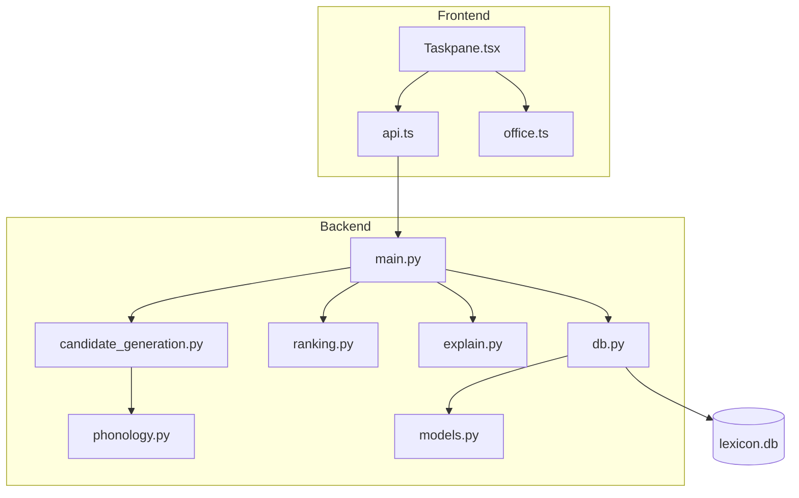
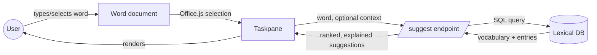

# System Architecture

This document specifies the architecture implemented in `backend/` and
`frontend/`. Diagrams are Mermaid; GitHub and most Markdown viewers render
them natively.

## Figure 1 — Overall System Architecture



## Figure 2 — Candidate Generation Workflow



## Figure 3 — Orthographic Similarity Model

The similarity model operates on *phonemic tokens*, not raw characters.
Weighted substitution costs are lower for edits that correspond to
contrastive Afaan Oromo orthographic phenomena (Table 1), so a
vowel-length or gemination difference scores as "closer" than an
arbitrary substitution of equal character-edit-distance.



## Figure 4 — Lexical Disambiguation Pipeline

```mermaid
flowchart TD
    A[Ranked candidates] --> B[build_suggestions<br/>top_k selection]
    B --> C[explain_difference per candidate<br/>dominant edit-operation]
    C --> D[render_message<br/>'Did you mean X (meaning) or Y (meaning)?']
    C --> E[render_explanations<br/>per-candidate detail lines]
    D --> F[SuggestResponse JSON]
    E --> F
```

## Figure 5 — Microsoft Word Plugin Architecture

```mermaid
flowchart TD
    subgraph Word["Word Desktop / Word Online"]
        M[manifest.xml] --> R[Ribbon button:<br/>Oromo Assistant > Check Spelling]
        R --> T[Taskpane.html]
    end
    T --> TC[Taskpane.tsx<br/>React component]
    TC --> OFF[office.ts<br/>Office.js: read selection]
    TC --> API[api.ts<br/>fetch(/suggest)]
    API -->|HTTPS| BE[FastAPI backend]
    OFF -->|Word.run| DOC[(Active document)]
```

## Component Diagram



## Data Flow Diagram



## Scaling the search

`candidate_generation.generate_candidates` is brute-force over the full
vocabulary, which is adequate for the seed lexicon (tens of entries) and
for evaluation on a moderate-size dataset. For a production-scale lexicon
(tens of thousands of entries), replace the linear scan with either:

1. A **BK-tree** keyed on the weighted token-edit distance (the distance
   satisfies the triangle inequality, so BK-tree pruning is valid), or
2. A **phoneme n-gram inverted index** (index each lexicon word by its
   bigrams of phonemic tokens; only score candidates sharing at least one
   bigram with the query).

Both are drop-in replacements behind `generate_candidates`'s interface and
do not change `ranking.py` or `explain.py`.

## Deployment

- **Backend**: containerize `backend/` (FastAPI + Uvicorn) behind HTTPS;
  the Office Add-in's `AppDomains` in `manifest.xml` and the CORS origin
  in `main.py` must both be updated from `localhost` to the deployed
  domain before distribution.
- **Frontend**: `npm run build` produces static assets (`dist/`) served
  over HTTPS (Office Add-ins require HTTPS `SourceLocation`); the
  manifest can then be distributed via AppSource, centralized deployment
  (Microsoft 365 admin center), or sideloading for evaluation.
